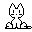

kairo  
=====

The ever popular kitty-that-follows-your-mouse-pointer toy.

Kairo is a playful desktop cat that follows your mouse pointer and keeps you company.

There are many versions of this idea. This project is released under the Unlicense.

This fork builds on the classic Java desktop cat concept and keeps the spirit of the original toy while rebranding it as Kairo.

The image files are ancient public domain.
The Java code for v.1.0 is (c) 2010 Werner Randelhofer.
The Java code for v.2.0 (c) 2019 Gerald Reno

Download executable jar
=====
[Download v.2.0.1](https://glreno.github.io/kairo/kairo-2.0.1.jar)

links
=====

[Source](https://github.com/glreno/kairo)
[Project wiki](https://github.com/glreno/kairo/wiki)
[History](https://en.wikipedia.org/wiki/Cat) 
